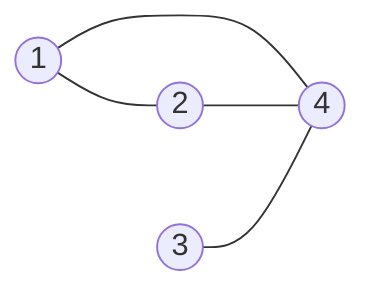

> ⚠️ 저작권 보호를 위해 원문 지문은 싣지 않았습니다. 공개 문제 [Codeforces 345D "Chain Letter"](https://codeforces.com/problemset/problem/345/D)와 규칙이 같은 문제로, 문장을 새로 쓰고 입출력을 SWEA 형식으로 바꿨습니다. 예제는 Codeforces 공개 예제입니다.

# 1. 편지

N명의 친구에게 1번부터 N번까지 번호가 붙어 있다. 누가 누구와 연락하는지는 N×N 배열로 주어진다. i번째 줄의 j번째 값이 1이면 i번과 j번은 서로 편지를 주고받을 수 있고, 0이면 그럴 수 없다. 연락은 양방향이다.

편지는 다음 규칙에 따라 퍼진다.

1. 1번이 연락하는 모든 사람에게 편지를 보내며 시작한다.
2. 편지를 **처음** 받은 사람은 연락하는 모든 사람에게 편지를 한 번 보낸다. 그 뒤로 또 받아도 다시 보내지 않는다.
3. 1번은 이미 처음에 보냈으므로, 나중에 편지를 받아도 다시 보내지 않는다.
4. N번은 편지를 받기만 하고 아무에게도 보내지 않는다.

더 이상 오가는 편지가 없을 때, N번이 받은 편지가 모두 몇 통인지 구하라.

### 예시 (입력 예의 테스트 케이스 #1)

```
4
0 1 0 1
1 0 0 1
0 0 0 1
1 1 1 0
```

연락 관계: 1–2, 1–4, 2–4, 3–4



- 1번이 2번, 4번에게 보낸다.
- 2번은 처음 받았으므로 1번, 4번에게 보낸다. (1번은 받아도 다시 보내지 않는다.)
- 3번은 4번하고만 연락하는데 4번은 보내지 않으므로, 3번은 편지를 받지 못한다.
- 4번이 받은 편지는 1번과 2번이 보낸 **2통**이다.

## [제약사항]

1. 사람 수 N은 2 이상 50 이하이다. (Codeforces 345D 기준)
2. 배열의 값은 0 또는 1이다.
3. i번째 줄 j번째 값과 j번째 줄 i번째 값은 같고, i번째 줄 i번째 값은 0이다.

## [입력]

첫 줄에 테스트 케이스의 수 T가 주어진다. 각 테스트 케이스의 첫 줄에는 N이, 다음 N줄에는 배열이 한 줄에 N개씩 공백으로 구분되어 주어진다.

## [출력]

테스트 케이스마다 `#t`(t는 1부터 시작하는 테스트 케이스 번호)와 공백 한 칸 뒤에 N번이 받은 편지 수를 출력한다.

## 입력 예 / 출력 예

입력: [input.txt](input.txt) · 출력: [output.txt](output.txt)

| 케이스 | 입력 내용 | 정답 | 이유 |
|---|---|---|---|
| #1 | 위 예시 | 2 | 1번·2번이 4번에게 보냄, 3번은 못 받음 |
| #2 | 모두 서로 연락 | 3 | 1·2·3번이 모두 4번에게 보냄 |
| #3 | 4번은 아무와도 연락 안 함 | 0 | 4번에게 보낼 사람이 없음 |

## 해설

편지가 퍼지는 과정은 그래프 탐색이다. 사람마다 처음 받았을 때 한 번만 보내므로 방문 체크를 하는 BFS로 그대로 따라가면 된다. N번에게 편지가 갈 때마다 개수를 세고, N번은 큐에 넣지 않는다.

정리하면 답은 **"N번을 거치지 않고 1번에서 닿는 사람(1번 포함) 중 N번과 연락하는 사람의 수"**다. 보내는 순서와 상관없이 이 사람들은 결국 한 번씩 보내므로 DFS로 풀어도 답이 같다.

시간 복잡도: O(N²)

### 자주 하는 실수

| 실수 | 결과 |
|---|---|
| N번을 큐에 넣음 | N번이 편지를 보내 3번 같은 사람이 받게 됨 |
| 받을 때마다 다시 보냄 | 1번과 2번이 끝없이 주고받음 |
| 1번을 방문 처리하지 않음 | 1번이 다시 받아 한 번 더 보냄 |
| N번에게 온 편지를 한 번만 셈 | 보낸 사람 수만큼 세야 함 |
